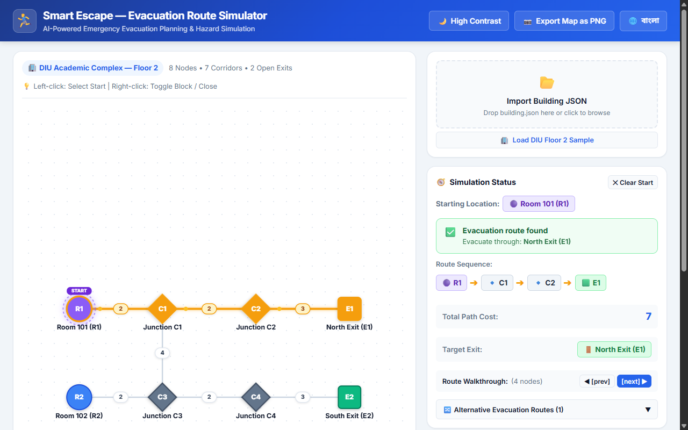
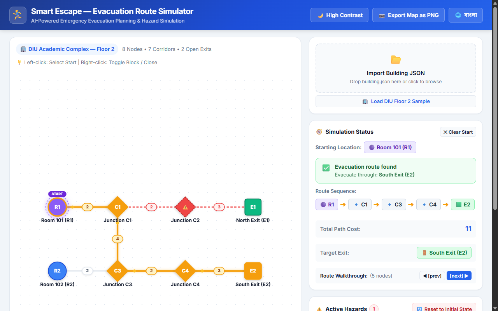

# Smart Escape — Interactive Evacuation Route Simulator

**AI DevFest 2026 — AI Vibe-Coding Contest (Solo)**  
**Daffodil International University**

A high-performance, bilingual web application designed for building safety administrators, facility managers, and emergency planners to simulate corridor blockages, room unavailability, and exit closures to discover and plan optimal evacuation routing under hazardous conditions.

---

## Author
- **Name:** Md. Abirul Islam Pritom
- **Registration Number:** 253-15-198
- **Repository:** [https://github.com/abirulislampritombackup1-sketch/devfest--253-15-198-](https://github.com/abirulislampritombackup1-sketch/devfest--253-15-198-)

## Live Site
🔗 **[https://devfest--253-15-198-.vercel.app]([https://devfest--253-15-198-.vercel.app](https://vercel.com/the-builder5/devfest-253-15-198)
)**

---

## How to Run Locally

1. **Clone the repository:**
   ```bash
   git clone https://github.com/abirulislampritombackup1-sketch/devfest--253-15-198-.git
   cd devfest--253-15-198-
   ```

2. **Install dependencies:**
   ```bash
   npm install
   ```

3. **Start the development server:**
   ```bash
   npm run dev
   ```

4. **Open in browser:**
   Navigate to `http://localhost:5173` in Google Chrome or any modern browser.

5. **Build for production:**
   ```bash
   npm run build
   ```

---

## Main Features Implemented

- [x] **Import and Validate `building.json`**: Supports file picker and drag-and-drop. Strictly validates all fields (building name, node types, coordinates, edge validity, integer costs, and initial states) with friendly error alerts.
- [x] **Interactive Graph Map (SVG)**: Renders all nodes at exact `(x, y)` coordinates. Visually distinct shapes: Rooms (● circle), Junctions (◆ diamond), Exits (■ square). Edges show cost badges at midpoints.
- [x] **Select Starting Location**: Click any unblocked room or junction to set as the evacuation start point. Exits cannot be set as starting points.
- [x] **Dijkstra Shortest Path Routing**: Calculates the lowest-cost route to the nearest open exit based solely on the sum of corridor costs.
- [x] **Deterministic Tie-Breaking Rules**:
  1. Lowest total cost.
  2. On cost tie: choose the lexicographically smallest exit ID (e.g., `E1` over `E2`).
  3. On path tie to the same exit: choose the lexicographically smallest node sequence (element-by-element comparison).
- [x] **Hazard Simulation & Toggling**:
  - Right-click / Shift-click or use panel buttons to block/unblock rooms and junctions.
  - Right-click / Shift-click corridors to block/unblock them.
  - Right-click / Shift-click exits to close/reopen them.
  - Blocked nodes show red hazard overlays and dashed incident corridors. Closed exits show red indicators with ✕ symbols.
- [x] **Automatic Route Recalculation**: Path instantly recalculates upon any hazard state change without reimporting.
- [x] **Reset to Initial State**: Single-click reset button restores the building's original `initial_state` configuration.
- [x] **Failure Cases Handled**:
  - `"No route available"` when all paths to open exits are blocked or disconnected.
  - `"Starting location blocked"` when the selected start room or junction becomes blocked by a hazard.
- [x] **Bilingual i18n (Bangla ↔ English)**:
  - Instant toggle button with full coverage of all UI labels, statuses, instructions, legends, and messages.
  - Clean font rendering with Google Font **Noto Sans Bengali**.
  - Persistent language selection using `localStorage`.
  - Dataset identifiers (`R1`, `C2`, `E1`) remain consistent per rules.
- [x] **Subtle Animations**:
  - Smooth scale transitions on node selection.
  - Glowing amber pulse and animated flow directional markers on the active evacuation path.
  - Animated dashed strokes on blocked hazard corridors.
- [x] **Deliverable Screenshots**: Captured and stored in `screenshots/`:
  - `screenshots/baseline-route.png`: Route from `R1` to `E1` with total cost 7.
  - `screenshots/rerouted-after-c2-blocked.png`: Route from `R1` to `E2` with total cost 11 after blocking `C2`.

---

## Bonus Features Implemented

- [x] **Alternative Evacuation Routes (Bonus B3)**: Displays top 2nd and 3rd alternative open evacuation paths and their total costs.
- [x] **High-Contrast / Accessible Dark Mode (Bonus B2)**: Toggle between standard and high-contrast dark mode for emergency visibility and accessibility.
- [x] **PNG Map Export (Bonus B4)**: One-click export button generates and downloads a high-resolution PNG image of the current floor plan and active evacuation route.
- [x] **Hazard State Persistence (Bonus B1)**: Save and restore custom hazard configurations to and from `localStorage`.
- [x] **Step-by-Step Route Walkthrough (Bonus B5)**: Interactive `[prev]` / `[next]` controls to inspect each step of the evacuation route node by node.

---

## Verified Contest Test Scenarios

| Scenario | Actions | Expected Output | Actual Output | Status |
| :--- | :--- | :--- | :--- | :---: |
| **T1: Baseline** | Select `R1` (initial state) | Route: `R1 → C1 → C2 → E1`, Cost: `7`, Exit: `E1` | `R1 → C1 → C2 → E1`, Cost: `7`, Exit: `E1` | ✅ PASS |
| **T2: Blocked Junction** | Select `R1`, block `C2` | Route: `R1 → C1 → C3 → C4 → E2`, Cost: `11`, Exit: `E2` | `R1 → C1 → C3 → C4 → E2`, Cost: `11`, Exit: `E2` | ✅ PASS |
| **T3: Exits Closed** | Select `R1`, close `E1` and `E2` | Status: `No route available` | Status: `No route available` | ✅ PASS |
| **T4: Different Start** | Select `R2` (initial state) | Route: `R2 → C3 → C4 → E2`, Cost: `7`, Exit: `E2` | `R2 → C3 → C4 → E2`, Cost: `7`, Exit: `E2` | ✅ PASS |
| **T5: Blocked Start** | Select `R1`, block `R1` | Status: `Starting location blocked` | Status: `Starting location blocked` | ✅ PASS |

---

## Screenshots

### 1. Baseline Route (R1 → E1, Cost 7)


### 2. Rerouted Route after Blocking C2 (R1 → E2, Cost 11)


---

## Known Issues
- None. All required main features, edge cases, and bonus items perform without runtime errors.

---

## AI Tools Used
- **Antigravity IDE** powered by **Google Gemini 3.8 Flash (High)** for autonomous code generation, validation testing, and headless verification.

## Most Useful Prompt
> "Implement Dijkstra's shortest path algorithm with deterministic tie-breaking (lowest cost -> lexicographically smallest exit ID -> lexicographically smallest node sequence) and auto-recalculating interactive SVG building evacuation map with bilingual English/Bangla i18n support."

---

## License
[MIT License](./LICENSE) © 2026 Md. Abirul Islam Pritom
